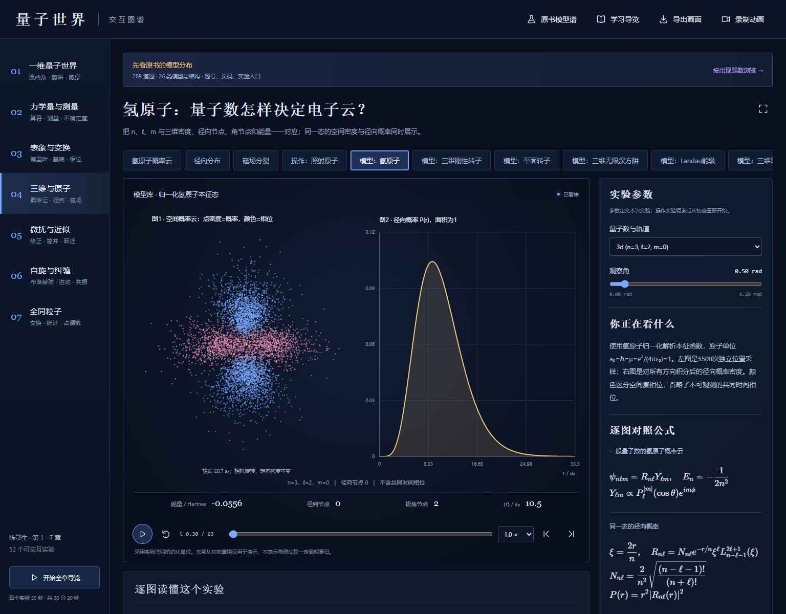

# 量子世界 · 交互实验室

用可调参数的动画、概率云、能级和数学公式，理解量子态与真实物理操作之间的关系。

**[直接进入在线实验室](https://liu2678294813-cpu.github.io/quantum-world-lab/)** · **[下载离线版 ZIP](https://liu2678294813-cpu.github.io/quantum-world-lab/downloads/quantum-world-offline.zip)**



## 可以做什么

- 按陈鄂生《量子力学习题与解答》第1—7章组织的 **52个交互实验**。
- **103份逐图说明与103块数学排版公式**，解释坐标、单位、颜色、阅读方式和模型条件。
- **289道编号题、26类模型与结构**的可搜索模型谱，可查看题号、印刷页与PDF页，并导出CSV。
- 暂停、定位时间、调整参数、关键时刻、全章导览、PNG导出、浏览器视频录制。
- 单文件离线运行，数学字体内嵌，无需账号或API；动画在访问者自己的浏览器中计算。

包含谐振子与耦合振子、氢原子、无限/有限深阱、δ势、平面/空间/非对称转子、Landau能级、球形阱、磁通圆环、Rabi、自旋分束、双自旋交换、L·S、全同粒子与接触相互作用等代表场景。

## 怎样开始

1. 打开在线网址，先点“原书模型谱”，按模型或题号寻找实验。
2. 每次只改变一个参数，对照逐图说明和公式。
3. 空格播放/暂停；左右方向键切换实验；导览共30分20秒。
4. 离线使用：下载ZIP并解压，用Edge或Chrome打开 `量子世界.html`。手机录制能力依浏览器而定。

## 科学范围

电子云是独立概率样本，不是电子的经典轨迹；自旋箭头表示态或期望值；相机旋转不代表定态密度运动。解析解、有限维精确模型与近似均有具体说明。

统计以编号题为单位，同题同模型计一次，复合题可以属于多个模型族，族间题数不可相加。模型族归并是对题干的人工语义分类；题号与页码已对照用户提供的446页PDF核对。原书PDF及其完整题干/解答不在本仓库。52个实验是代表模型，不是289题的逐题模拟；未实现的变式在模型谱中注明。

## 文档与验证

- [模型频率与逐题归类](小黄书物理模型盘点.md)
- [逐场景学习导览](学习导览.md)
- [使用说明](使用说明.md)
- [289题CSV对照](source-notes/model-question-map.csv)
- [物理验证记录](verification/physics-qa.json)：35组通过，包括归一化、边界、薛定谔方程残差、幺正性和束缚阈值。
- [浏览器验证记录](verification/browser-qa.json)：52场景及参数端点/选项、图片和录制下载、手机布局、零外部网络请求。

## 本地开发与更新

```sh
python build.py
node --test tests/physics.test.cjs tests/models.test.cjs
python publish.py
```

无需安装Python或Node依赖即可构建与运行数值测试。浏览器测试脚本中的Playwright/Chrome路径需按本机安装位置调整。`publish.py`重新生成 `docs/` 首页和离线下载包；GitHub Pages从 `main` 分支的 `/docs` 发布。提交并推送后站点会更新。

KaTeX 0.19.1及字体随仓库提供，保留其[MIT许可证](vendor/katex/LICENSE)与[来源记录](vendor/katex/provenance.json)。
